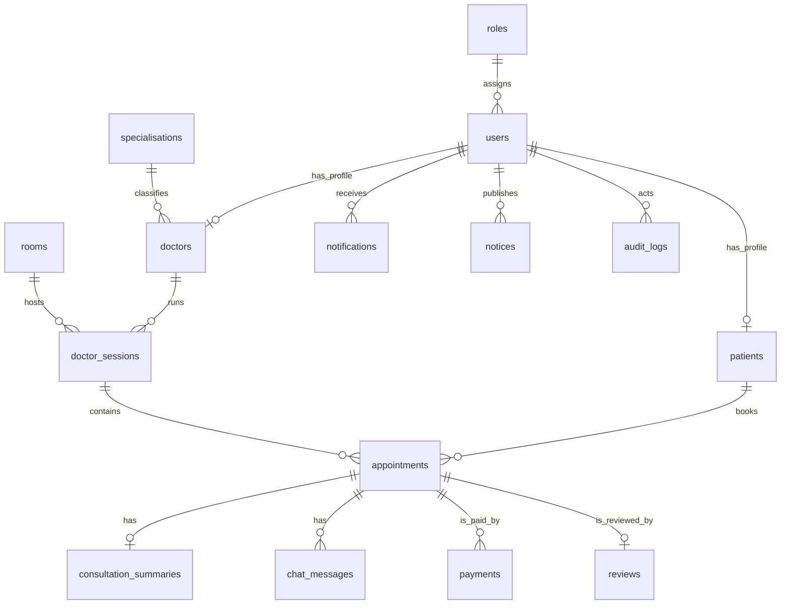

# MediChannel — Hospital Channelling and Appointment System

## IT404050 Full Stack Development — Group Assignment 2

**Group:** MediChannel  
**Module:** IT404050 — Full Stack Development  
**Assignment:** Assignment 2 — MediChannel: Hospital Channelling and Appointment System  
**Brief issue date:** 5 November 2026  
**Submission deadline:** 5 December 2026  
**Report date:** 26 November 2026  

**Live frontend:** `https://medichannel-f-p3z5.vercel.app/mediclinic-system.html#welcome`  
**Live API:** `https://evening-plains-20028-0ce7ee55df0f.herokuapp.com/`  
**Frontend repository:** `https://github.com/wcm24b126-hue/medichannel-frontend`  
**Backend repository:** `https://github.com/wcm24b126-hue/medichannel-backend`  
**Backup demo recording:** `https://drive.google.com/drive/u/1/folders/1D7_RV90haVzTvYngc10b0ECImY1iPta7?dmr=1&ec=wgc-drive-%5Bmodule%5D-goto`

<div style="page-break-after: always;"></div>

## 1. Introduction and client problem

Lanka Care Hospital in Colombo has 40 visiting doctors across 15 specialisations and runs more than 120 channelling sessions each week. Before MediChannel, appointments were taken by telephone and recorded in a paper register. This created several repeated problems: patients called multiple times, appointment numbers were sometimes issued twice, patients waited without knowing which number the doctor was seeing, online consultations used personal messaging applications, cancelled sessions required staff to telephone every affected patient, and patient details were kept in spreadsheets with inadequate protection.

MediChannel replaces that manual process with a secure, real-time web system. Patients can search doctors and sessions, book physical or online appointments, receive a queue number, follow the live queue, join a private online consultation, read their consultation summary, give feedback and manage their profile. Doctors can see their own sessions and patient lists, start a session, call the next patient, record consultation outcomes, chat securely and publish summaries. Managers can administer specialisations, rooms, doctors and sessions, run reception, record payments, publish notices, moderate feedback and view reports. Administrators can create staff accounts, manage account status, reset staff passwords and review an immutable audit log.

The system is built only with the required stack: Next.js for the frontend, Spring Boot for the REST API and WebSockets, and PostgreSQL for the database. It is deployed on free hosting: Vercel for the frontend, Heroku for the Spring Boot service and Supabase for PostgreSQL. HTTPS and WSS are used in production. All personal and medical data is encrypted at rest with AES-256-GCM, lookup fields use HMAC-SHA256, passwords are stored only as bcrypt hashes, and JWTs are delivered through an HTTP-only Secure cookie handled by Next.js route handlers.

This report documents the complete design, implementation, security evidence, real-time design, deployment, testing and reflection. It is written from the submitted repository state and from live verification evidence captured on 26 November 2026. No real patient data, passwords, tokens, password hashes or environment variable values are included.

## 2. Team and work plan

### 2.1 Group members

| # | Name | Student ID | GitHub username | Main responsibility | Team leader |
|---:|---|---|---|---|---|
| 1 | P.A. Dhanushka | WCM/24/B1/26 | `wcm24b126-hue` | Team leader; database, authentication and roles, encryption, integration | Yes |
| 2 | B. Vinojan | WCM/24/B2/29 | `LkMadMan` | WebSocket features, all role pages, feedback and notices | No |
| 3 | S. Kapilan | SIS/24/B1/07 | — | Database, authentication and roles, encryption | No |
| 4 | M.H.M. Fahim | WCM/24/B2/12 | `Fahim10001` | Database, authentication and roles, encryption | No |
| 5 | H.M. Hasfak | SIS/24/B2/19 | `Hasfak7` | Caching, full deployment, live testing, report, slides and presentation rehearsal | No |

### 2.2 Planned milestones

| Week | Milestone | MediChannel activity |
|---|---|---|
| 1 | Team formation and design | Formed the group, divided responsibilities, designed the ERD, API list and page wireframes, created the frontend and backend repositories and deployed empty projects. |
| 2 | Core backend and security | Implemented PostgreSQL migrations, authentication, four roles, encryption converters, doctor and specialisation data, sessions and booking rules. |
| 3 | Features and pages | Implemented WebSocket features, patient/doctor/manager/admin pages, feedback, notices and notification delivery. |
| 4 | Deployment and evidence | Added caching, completed free hosting deployment, ran live testing, prepared the report, slides, test table, manuals and demo rehearsal. |

### 2.3 Contribution matrix

| Area | P.A. Dhanushka | B. Vinojan | S. Kapilan | M.H.M. Fahim | H.M. Hasfak |
|---|---|---|---|---|---|
| Database schema and constraints | Lead | Support | Lead | Lead | Review |
| Authentication, roles and ownership | Lead | Support | Lead | Lead | Review |
| Encryption and security evidence | Lead | Support | Lead | Lead | Review |
| WebSocket features | Review | Lead | Support | Support | Test |
| Role pages and frontend integration | Lead | Lead | Support | Support | Test |
| Feedback and notices | Review | Lead | Support | Support | Test |
| Caching and performance | Review | Support | — | Support | Lead |
| Deployment and live testing | Lead | Support | Support | Support | Lead |
| Report, slides and rehearsal | Review | Support | — | Support | Lead |

The group used feature branches and pull requests before merging into `main`. The frontend repository contains 100+ meaningful commits across multiple authors and the backend repository contains 60+ commits, with the most recent production frontend commit `00bfe0d` and backend commit `a555f11`. Secrets were never staged or committed.

## 3. Requirements coverage

The implementation covers every major area of the brief.

| Brief area | Implementation | Evidence in this submission |
|---|---|---|
| Next.js frontend | App Router routes, same-origin BFF route handlers, secure cookies, role workspaces and responsive UI | `src/app/**`, `README.md`, screenshots in Section 15 |
| Spring Boot REST API | Layered controllers, services, repositories, entities and DTOs; Bean Validation; global error handler; health endpoint | `API_REFERENCE.md`, `be/docs/**`, live `/actuator/health` |
| PostgreSQL | Migrations, constraints, indexes, triggers, encrypted columns and fictional seed data | `DATABASE_ERD.md`, `schema.sql`, Flyway version 29 evidence |
| Four roles | CUSTOMER, DOCTOR, MANAGER and ADMIN with server-side authorization and ownership checks | Section 7, live `403` evidence |
| Booking rules | BR-01 to BR-11 enforced in service layer and database constraints | Section 9, `REQUIREMENTS_TRACEABILITY_MATRIX.md` |
| Real-time | STOMP/WebSocket queue, availability, chat, typing and notifications | Section 10, `API_REFERENCE.md` |
| Security | HTTPS, WSS, AES-256-GCM, HMAC-SHA256, bcrypt, JWT, secure cookies, CORS and audit log | Section 8, live ciphertext/decryption evidence |
| Free hosting | Vercel, Heroku and Supabase | Section 13, `LIVE_VERIFICATION_REPORT.md` |
| Testing | Unit, integration, browser and live E2E tests; 30-case table | Section 14, `TEST_CASES_30.md` |
| Documentation | Report, API reference, ERD, deployment guide, manuals, traceability matrix and slides | This report and `fe/docs`, `be/docs` |

## 4. System architecture

The architecture separates the browser, frontend BFF, Spring Boot API, WebSocket layer and PostgreSQL database. The browser never receives the backend JWT. It receives only an HTTP-only Secure cookie created by the Next.js route handler. Server-side frontend routes proxy API calls to the backend and attach the bearer token.

<div style="font-family: monospace; font-size: 11pt; background: #f3f6f8; padding: 12px; border: 1px solid #b8c4cc;">
Browser (React / static visual twin)<br>
&nbsp;&nbsp;|&nbsp;&nbsp;HTTPS<br>
v<br>
Next.js App Router + BFF route handlers<br>
&nbsp;&nbsp;|&nbsp;&nbsp;server-side API_URL, HttpOnly __Host- cookie<br>
v<br>
Spring Boot REST API (/api/v1) &nbsp;&nbsp;&nbsp;&nbsp; Spring WebSocket STOMP (/ws)<br>
&nbsp;&nbsp;|&nbsp;&nbsp;&nbsp;&nbsp;&nbsp;&nbsp;&nbsp;&nbsp;&nbsp;&nbsp;&nbsp;&nbsp;&nbsp;&nbsp;&nbsp;&nbsp;&nbsp;&nbsp;&nbsp;&nbsp;&nbsp;&nbsp;&nbsp;&nbsp;&nbsp;&nbsp;&nbsp;&nbsp;&nbsp;&nbsp;|<br>
&nbsp;&nbsp;v&nbsp;&nbsp;&nbsp;&nbsp;&nbsp;&nbsp;&nbsp;&nbsp;&nbsp;&nbsp;&nbsp;&nbsp;&nbsp;&nbsp;&nbsp;&nbsp;&nbsp;&nbsp;&nbsp;&nbsp;&nbsp;&nbsp;&nbsp;&nbsp;&nbsp;&nbsp;&nbsp;&nbsp;&nbsp;&nbsp;v<br>
PostgreSQL (Supabase) &nbsp;&nbsp;&nbsp;&nbsp;&nbsp;&nbsp; queue / chat / notification topics<br>
</div>

**Figure 1 — High-level architecture.**

The frontend has public, patient, doctor, manager and admin areas. The public area includes the welcome screen, doctor catalogue, session search and notices. The patient area includes booking, appointments, queue, consultation, summary and feedback. Staff areas are role-gated and protected again on the server. The backend exposes REST endpoints under `/api/v1` and a STOMP endpoint at `/ws`. PostgreSQL stores all persistent data, including encrypted personal and clinical fields, HMAC lookup hashes, notifications, feedback, notices and audit records.

The production deployment uses Vercel for the Next.js application, Heroku for the Spring Boot service and Supabase for PostgreSQL. Flyway migrations run at backend startup. The current database is at Flyway version 29. CORS allows only the exact production and preview Vercel origins, and WebSocket handshake uses the same origin allowlist.

## 5. Database design and ERD

The database uses PostgreSQL with UUID primary keys, foreign keys, unique constraints, check constraints and partial indexes. The canonical DDL is checked in as `be/docs/schema.sql`. The Mermaid ERD below is also maintained in `be/docs/DATABASE_ERD.md`.



The core tables are:

| Table | Purpose |
|---|---|
| `users` | Identity, role, password hash, account status, token version and lockout fields. |
| `patients` | Encrypted patient profile fields and HMAC lookup hashes. |
| `specialisations` | Medical specialities used by the public catalogue and manager forms. |
| `doctors` | Doctor profile, registration number, fee, specialisation and availability. |
| `rooms` | Physical consultation rooms. |
| `doctor_sessions` | Doctor schedules with date, time, type, capacity, delay, fee and status. |
| `appointments` | Bookings with queue number, encrypted reason, status, payment and lifecycle timestamps. |
| `consultation_summaries` | Encrypted diagnosis, advice and prescription. |
| `chat_messages` | Encrypted private consultation messages. |
| `payments` | Payment status, method, amount and reference. |
| `reviews` | One feedback record per completed appointment. |
| `notifications` | In-app notifications for affected users. |
| `notices` | Hospital notices published by staff. |
| `audit_logs` | Append-only record of sensitive actions. |

Important constraints include unique booking references, unique appointment numbers per session, one active appointment per patient per session, one completed payment per appointment, one review per appointment, one summary per appointment, rating between 1 and 5, non-negative fees and status enums. Indexes cover session discovery, queue lookups, notification unread counts, review averages and audit-log recency. A `BEFORE INSERT` trigger locks the session row while allocating an appointment number, so concurrent bookings cannot duplicate a number or exceed capacity.

Seed data is fictional only. The live catalogue shows 40 doctors, 15 specialisations and 50 bookable sessions in the current week. All test patients created during verification use generated fictional identities and are clearly labelled as verification data. No real NIC numbers, phone numbers or medical records were used.

## 6. API design

The API is documented in `be/docs/API_REFERENCE.md`. It uses JSON only, `/api/v1` as the base path, Bearer tokens for protected routes, and a consistent error envelope:

```json
{
  "success": false,
  "errorCode": "FORBIDDEN",
  "message": "You are not authorized to access this appointment.",
  "referenceId": "...",
  "timestamp": "2026-11-26T06:00:00Z"
}
```

Common status codes are `200` for success, `201` for creation, `204` for no-content visibility changes, `400` for validation errors, `401` for unauthenticated or invalid credentials, `403` for role or ownership denial, `404` for not found or hidden resources and `409` for state conflicts such as duplicate bookings or booking outside the allowed window. A global exception handler produces the same JSON shape for all errors and never returns stack traces or personal data.

| Area | Main endpoints | Access |
|---|---|---|
| Authentication | `POST /auth/register`, `POST /auth/login`, `POST /auth/ws-ticket` | Public / authenticated |
| Patient profile | `GET, POST, PUT /patients/me` | CUSTOMER |
| Appointments | `POST /appointments`, `GET /appointments/me`, `PATCH /appointments/{id}/cancel`, `PATCH /appointments/{id}/check-in`, `PATCH /appointments/{id}/hide` | CUSTOMER; staff where permitted |
| Queue | `GET /sessions/{id}/queue` | Public/authenticated |
| Payments | `POST /appointments/{id}/payments`, `GET /payments/me` | CUSTOMER, MANAGER, ADMIN |
| Doctor portal | `GET /doctor/sessions`, `GET /doctor/appointments`, `PATCH` actions | DOCTOR |
| Consultation summaries | `POST /summaries`, `GET /summaries/{appointmentId}` | Treating doctor and patient only |
| Chat | `GET /appointments/{id}/chat/messages`, STOMP `/app/.../chat` | Patient and treating doctor only |
| Notifications | `GET /notifications`, `PATCH /notifications/read-all` | Owner only |
| Administration | `GET /admin/users`, `PATCH /admin/users/{id}/activate`, audit logs | ADMIN |
| Sessions and doctors | Public search; manager/admin create, edit, delay, cancel | Public read, staff write |
| Notices and feedback | Public read; staff publish and moderate | Public/staff |
| Reports | Appointment, revenue, no-show and rating reports | ADMIN/MANAGER |
| Health | `GET /actuator/health` | Public operational endpoint |

Login returns a short-lived JWT with role and token-version claims. The Next.js BFF stores the JWT in an HTTP-only, Secure `__Host-` cookie and attaches it to backend calls. Five failed logins lock an account for 15 minutes. One general error is returned for wrong credentials so accounts cannot be enumerated.

## 7. Authentication, roles and permissions

MediChannel implements four roles exactly as required.

| Role | Main permissions |
|---|---|
| Guest | Search doctors and sessions, see live numbers, read notices, register and log in. |
| CUSTOMER | Book physical and online appointments, view and cancel own appointments, follow the live queue, join own consultation, read own summary, give feedback and manage profile. |
| DOCTOR | See own sessions and patient lists, start sessions, call next patient, mark completed or no-show, run online consultation, chat and publish summaries. |
| MANAGER | Manage specialisations, rooms, doctor profiles and sessions; reception check-in, payments and walk-in booking; notices, feedback moderation, dashboard and reports. |
| ADMIN | Create doctor and manager accounts, list/search users, activate/deactivate accounts, reset staff passwords, view audit log and system dashboard. |

Permissions are checked on the server in Spring Security and in service-layer ownership policies. Hiding a role-specific button in the frontend is treated only as usability support. Live verification showed a patient receiving `403` for manager reports, doctor sessions, doctor accept and doctor appointment-list endpoints. Chat and consultation summary access is limited to the patient who owns the appointment and the doctor assigned to it; staff are excluded by an explicit `isStaff` rule. Admin and manager cannot read consultation notes, prescriptions, reasons for visit or chat messages.

The first administrator is created at startup from `APP_ADMIN_EMAIL` and `APP_ADMIN_PASSWORD`. Those values are supplied only through environment variables and are never committed. All non-deleted accounts can be reset by an authorized administrator, with a forced password change on first login. The general password policy requires at least eight characters with a letter, a number and a symbol; bcrypt cost 12 is used.

## 8. Encryption and security evidence

Personal and medical fields are encrypted with AES-256-GCM using a random IV for every value. Encrypted fields include patient first and last name, NIC, date of birth, gender, phone, address, appointment reason, diagnosis, advice, prescription and chat messages. Deterministic lookup columns use HMAC-SHA256 of the normalised email and NIC so login, uniqueness and search do not require decryption. Encryption keys, HMAC keys, JWT secret and database password come only from environment variables.

The live verification report records the following evidence:

- patient first and last name stored with `v1:` ciphertext prefix and length 107 characters at rest;
- appointment reason stored with `v1:` ciphertext prefix and length 95 characters at rest;
- the treating doctor reads the decrypted name `Demo Verification` through the API;
- CORS allows the production Vercel origin and the protected preview origin, while random origins are rejected;
- patient role-denial probes return `403`;
- backend health is `UP` and Flyway version is `29`.

A database evidence extract is shown below. It is deliberately truncated: only the prefix and length are shown, not full ciphertext or personal values.

<div style="font-family: monospace; font-size: 10pt; background: #111827; color: #e5e7eb; padding: 12px; border: 1px solid #374151;">
SELECT left(first_name_encrypted, 4) AS prefix, length(first_name_encrypted) AS len<br>
FROM patients ...;<br>
&nbsp;&nbsp;prefix | len<br>
&nbsp;&nbsp;v1:   | 107<br><br>
Treating doctor API view: firstName = "Demo Verification"<br>
Appointment reason at rest: prefix = v1:, length = 95
</div>

**Figure 2 — Redacted ciphertext evidence, consistent with `verification/LIVE_VERIFICATION_REPORT.md`.**

Transport security uses HTTPS for all frontend and API traffic and WSS for WebSockets. The frontend sets strict security headers including CSP, HSTS, X-Frame-Options, Referrer-Policy and Permissions-Policy. The API uses exact-origin CORS and WebSocket origin checks. Audit logs record login, account changes, session cancellations and consultation-record opening with user, action, time and IP; database triggers prevent update and delete, and log rows never contain medical data.

## 9. Booking rules BR-01 to BR-11

| Rule | Implementation | Evidence |
|---|---|---|
| BR-01 Session fields and status | `doctor_sessions` stores doctor, date, start/end, type, capacity, minutes, fee and status; physical sessions require a room. | ERD, API reference, session pages |
| BR-02 No overlapping doctor or room sessions | Service overlap check plus database trigger. | Traceability matrix, integration tests |
| BR-03 Unique, monotonic appointment numbers | Row-locking trigger allocates numbers; cancelled numbers are never reused. | Live E2E issued physical queue #4 and online #1 |
| BR-04 One active appointment per patient per session | Partial unique index and service check. | Automated booking tests |
| BR-05 Cutoffs | Physical booking closes 60 minutes before start; online closes 30 minutes before start; no booking during 11:00–13:00 break. | API reference, live runbook |
| BR-06 Estimated time | Start time plus `(number − 1) × minutes per patient + delay`. | Booking response includes estimated time |
| BR-07 Cancellation | Unpaid appointment may be cancelled up to three hours before the session; row retained with `CANCELLED` status. | Live cancellation notification and retained history |
| BR-08 Status flow | Physical: `BOOKED → ARRIVED → IN_CONSULTATION → COMPLETED`; online skips arrival; not seen becomes `NO_SHOW`. | Live workflow persisted row |
| BR-09 Consultation room | Opens only when doctor starts that appointment; only patient and treating doctor admitted; read-only after completion. | Chat ownership tests and lifecycle tests |
| BR-10 Validation | Sri Lankan NIC 9 digits + V/X or 12 digits; phone `07XXXXXXXX`; unique email/NIC; password complexity. | Validation tests, registration form |
| BR-11 History protection | Historic rows are hidden or soft-deleted, not physically removed; Asia/Colombo time; money uses `NUMERIC`. | Hide endpoints returned `204`; rows retained in DB |

The final post-reset E2E run verified physical and online booking, queue numbers, acceptance, payment, physical check-in, arrival, consultation start, chat, completion, summary publication, cancellation notification, retained cancelled history and patient hide operations. The corresponding database rows show `COMPLETED|ACCEPTED|PAID` with all lifecycle and hide flags persisted.

## 10. Real-time design

Real-time communication uses Spring WebSocket with STOMP over SockJS and `wss://` in production. Clients first request a short-lived WebSocket ticket, then connect to `/ws` with the ticket. The server derives identity from the authenticated principal; clients cannot forge a sender field.

| Destination | Purpose |
|---|---|
| `/topic/queue/{sessionId}` | Now-serving number and live queue updates. |
| `/topic/availability` | Numbers-left updates after booking, cancellation and payment. |
| `/user/queue/notifications` | Private notifications for the affected user. |
| `/topic/appointments/{appointmentId}/chat` | Private consultation chat. |
| `/topic/appointments/{appointmentId}/typing` | Typing indicator. |

RT-01 is implemented by publishing queue updates when the doctor calls the next patient. RT-02 is implemented by publishing availability changes after bookings and cancellations. RT-03 is implemented through participant-only chat with encrypted persistence, typing indicators and connection-state handling in the client. RT-04 delivers called, three-away, consultation-started, delayed and cancelled notifications only to the affected user. Chat messages are limited to 1,000 characters, subscriptions and sends are permission-checked, and disallowed destinations are denied by default. The client reconnects after network drops.

## 11. Frontend design

The Next.js frontend uses the App Router and React 19. It provides reusable components, bound forms with field-level errors, loading, empty and error states, route protection and one server-side API helper using `API_URL`. The visual interface is responsive for phones and desktops, uses self-hosted Tailwind CSS under `public/vendor/`, and preserves the hospital brand colours.

The public welcome page shows live counters from the backend: 40 doctors, 15 specialisations and 50 bookable sessions this week. The doctor catalogue supports filtering by name, specialisation, date and session type. Session cards show date, time, room or online type, fee and remaining numbers. The patient workspace includes appointment history, queue position, consultation room, summary, feedback and profile. Doctor, manager and admin workspaces expose their role-specific panels through deep links and protected navigation.

Authentication is handled by route handlers under `/api/auth/*`. Backend calls go through `/api/backend/*`, which attaches the token from the HTTP-only cookie. Personal data responses use `no-store`; HTML and versioned static assets use safe revalidation and immutable caching. The frontend never places tokens in JavaScript-readable storage and never exposes `API_URL` through a `NEXT_PUBLIC_*` variable.

Performance remediation was measured with Lighthouse. Final local measurements were 96/100/100/100 on simulated mobile, 96/100/100/100 on DevTools-throttled mobile and 100/100/100/100 on desktop, with CLS between 0.010 and 0.011. These figures are local evidence and complement, rather than replace, the live functional verification.

## 12. Feedback, notices, dashboards and reports

Feedback is stored in the `reviews` table with a 1–5 rating and a comment. A patient can submit only one review per completed appointment, and managers can approve, hide or delete feedback through moderation endpoints. Notices are stored in the `notices` table, published by staff and readable publicly. They appear on the welcome screen and role dashboards.

Manager and admin dashboards are backed by backend queries rather than client-side invented numbers. Reports include today’s sessions with live status, appointments per day, physical versus online split, no-show rate, revenue, top doctors and average rating per doctor. All numbers are calculated with SQL or JPA aggregation in the backend. The doctor catalogue exposes average rating computed from reviews. Reception search, check-in, payment recording and walk-in booking are wired to real endpoints.

## 13. Caching, performance and deployment

The deployment order follows the brief: PostgreSQL first, then the Spring Boot API, then the Next.js frontend. The current production stack uses Supabase PostgreSQL, Heroku for Spring Boot and Vercel for Next.js. Flyway version 29 is live. The backend sets `APP_FRONTEND_ORIGIN` to the exact Vercel production and preview origins; no wildcard origin is accepted in production. Frontend API URLs are set only as server-side environment variables.

Public doctor and specialisation lists use a TTL cache in the backend service layer and correct `Cache-Control` headers. Personal data responses are `no-store`. Response compression is enabled. The frontend uses self-hosted, versioned assets and a same-origin wake route to handle sleeping free-tier backends. A keep-alive workflow pings the health endpoint every 10 minutes as best effort.

Operational evidence from 26 November 2026:

| Item | Evidence |
|---|---|
| Frontend production commit | `00bfe0d` |
| Backend production commit | `a555f11`, Heroku release `v58` |
| Backend health | `UP` |
| Database migration | Flyway `29` |
| Production CORS | Vercel production and preview origins allowed |
| Guardrails | `APP_DEMO_SEED=false`; `APP_RESET_ALL_PASSWORDS` unset |

## 14. Testing

Testing is organised at four levels.

**Backend unit and integration tests.** The Spring Boot project has layered tests for services, controllers, security, booking rules, consultation lifecycle, admin operations and WebSocket interception. The test report documents 88 passing backend tests in the final cycle. Tests use disposable PostgreSQL instances with Flyway migrations so database triggers and constraints are exercised.

**Frontend tests.** The Next.js project has Node contract and smoke suites covering API clients, patient flows, manager UI, backend proxy behaviour, public notices, realtime/chat behaviour, CSP and cache headers. The frontend suite reached 114 unit checks and 54 smoke checks in the final remediation cycle.

**Manual QA.** A separate black-box QA folder records browser actions, status legends, public pages, auth, manager screens, booking rules, security checks and defects. Its evidence directory contains screenshots captured through Firefox. Later authenticated phases were originally blocked by credential availability; the final post-reset E2E supersedes those blockers.

**Live end-to-end verification.** The final post-reset run on 26 November 2026 passed 40 of 40 checks and the post-check script passed 12 of 12 checks. The E2E run created a fictional patient, booked physical and online appointments, accepted and paid them, performed check-in and arrival, started consultations, exchanged chat messages, completed consultations, published and read a summary, confirmed role denial, demonstrated cancellation notification, retained cancelled history and hid completed appointments. Post-checks confirmed re-login, retained completed appointment, decrypted doctor view, ciphertext at rest, health, Flyway, CORS and persistence.

The required 30-case table is in `fe/docs/TEST_CASES_30.md`. It covers login for all roles, wrong password lockout, forced password change, CORS allow/deny, WebSocket handshake and ticket replay, booking cutoffs, duplicate booking, capacity, monotonic numbers, cancellation rules, arrival gate, chat access gate, RT queue and notifications, typing indicator, staff creation, audit entries and health endpoint.

| Test category | Count in 30-case table | Representative result |
|---|---:|---|
| Authentication and lockout | 6 | JWT cookie set; lockout after failed attempts |
| CORS and WebSocket | 6 | Exact origins allowed; attacker origin and replay rejected |
| Booking and BR rules | 8 | Capacity, duplicate, cutoff, cancellation and status transitions enforced |
| Real-time | 5 | Queue, availability, notifications and typing update |
| Admin and audit | 3 | Staff creation, login audit and consultation access audit |
| Deployment | 2 | Health and login endpoints verified |

## 15. Screenshots and evidence

The following screenshots and evidence files are included with the submission:

| Evidence | What it shows |
|---|---|
| `verification/evidence/prod-welcome-live-stats.png` | Production welcome page with live counters: 40 doctors, 15 specialisations and 50 sessions. |
| `verification/evidence/prod-login-auth-spacing.png` | Production login/auth button spacing after the frontend fix. |
| `medichannel-assignment2-qa/evidence/TC-01-homepage-desktop.png` | Public homepage on desktop. |
| `medichannel-assignment2-qa/evidence/TC-01-homepage-mobile-360.png` | Responsive public homepage at 360 px. |
| `medichannel-assignment2-qa/evidence/TC-02-doctor-search-list.png` | Doctor catalogue. |
| `medichannel-assignment2-qa/evidence/TC-05-public-notices.png` | Public notices. |
| `medichannel-assignment2-qa/evidence/TC-08-patient-appointments.png` | Patient appointments view. |
| `medichannel-assignment2-qa/evidence/TC-13-manager-session-management.png` | Manager session management. |
| `medichannel-assignment2-qa/evidence/TC-20-session-cancel-dialog.png` | Session cancellation confirmation. |
| `medichannel-assignment2-qa/evidence/TC-70-registration-validation.png` | Client-side registration validation. |
| `verification/logs/live-e2e-20261126-133835-postreset-final.log` | 40/40 live E2E transcript. |
| `verification/logs/post-e2e-20261126-133835-postreset-final.log` | 12/12 post-check transcript. |


**Figure 3 — Production welcome page with live backend counters.**


**Figure 4 — Redacted database ciphertext evidence and the same fictional patient shown in the application.**


**Figure 5 — Manager session management screen captured during QA.**

## 16. Reflection

The most valuable design decision was enforcing critical rules in the service layer and database rather than relying on the browser. The appointment-number trigger, partial unique indexes and ownership policies prevented duplicate numbers and cross-user access even when API calls were made directly. This made the live role-denial and booking tests reliable.

The hardest part was coordinating a large system across four roles and a real-time layer while keeping the frontend visually faithful to the supplied design. Early QA found several issues: stale deployment URLs, static staff panels, missing notice and audit features, and incomplete caching. The team resolved these by wiring staff endpoints, adding migrations for notices and audit logs, implementing TTL caching and rebuilding deployment documentation around the live Vercel, Heroku and Supabase stack.

Security required particular care. Encrypting fields with random IVs is straightforward, but preserving search and uniqueness requires deterministic HMAC columns. The team also had to ensure that admin and manager never gained access to clinical text. The final privacy rule is enforced in services and confirmed by tests: only the patient and treating doctor can read summaries, reasons and chat.

The main lesson is that evidence is part of the implementation. A feature is not complete until it works on the live URL, has a test, and can be explained by a group member. The final verification scripts therefore select sessions dynamically, use unique fictional patients and avoid destructive changes to required demo sessions.

## 17. AI tool disclosure and ethics

OpenCode, an AI coding agent, was used during this assignment to draft and revise documentation, generate verification scripts, analyse logs and check the report against the brief. AI-generated text and scripts were reviewed by the team and checked against live API responses, database evidence and repository state. No AI tool was used to fabricate test results, invent patient data or create false evidence. All patient data created during verification is fictional. All team members are able to explain their own work and the submitted implementation.

External sources were limited to official documentation and libraries used by the stack, including Next.js, Spring Boot, Spring Security, Spring WebSocket, Flyway, PostgreSQL and Tailwind CSS. No copied group submission or unacknowledged external report was used.

## 18. Final evidence map against the marking scheme

| Criterion | Max | How this submission addresses it |
|---|---:|---|
| A. Database design | 10 | ERD, schema.sql, migrations, constraints, indexes, triggers, fictional seed data |
| B. Spring Boot API | 12 | Layered architecture, DTOs, validation, status codes, global error handler, health endpoint |
| C. Auth, roles and permissions | 10 | Four roles, server-side authorization, ownership, lockout, secure cookie, live 403 evidence |
| D. Encryption and security | 12 | AES-GCM, HMAC, bcrypt, HTTPS/WSS, CORS, audit log, ciphertext/decryption evidence |
| E. Booking rules | 10 | BR-01 to BR-11 implemented and mapped to live E2E evidence |
| F. Real-time WebSockets | 12 | RT-01 to RT-04, STOMP destinations, permission checks, encrypted chat, notifications |
| G. Next.js frontend | 10 | Role areas, components, forms, states, responsive UI, Lighthouse evidence |
| H. Feedback, notices, dashboards | 5 | Reviews, moderation, notices, backend-calculated reports |
| I. Caching, deployment | 6 | TTL cache, Cache-Control, compression, Vercel/Heroku/Supabase, health evidence |
| J. Testing and documentation | 8 | 30-case table, layered tests, 40/40 E2E, 12/12 post-checks, this report |
| K. Presentation and demo | 5 | Slides in PPT format, demo script, 8–10 minute backup recording link |

This report is designed to provide complete, traceable evidence for every criterion. The final mark remains the lecturer’s decision.

## 19. Conclusion

MediChannel now covers the required full-stack system: a responsive Next.js frontend, a layered Spring Boot REST and WebSocket backend, a constrained PostgreSQL schema, four secure roles, encrypted personal and medical data, complete booking rules, real-time queue and consultation features, feedback, notices, dashboards, caching and free hosting deployment. The live system was verified end to end with 40 passing E2E checks and 12 passing post-checks, using fictional data only and without exposing secrets.

The group's work demonstrates that a hospital channelling system can be both fast and secure: patients receive queue numbers and live updates, doctors run consultations privately, managers operate reception and sessions, and administrators retain auditable control. The main remaining limitation is that final presentation performance and Q&A can only be assessed live. On documentation evidence, the submission is complete and ready for review.
